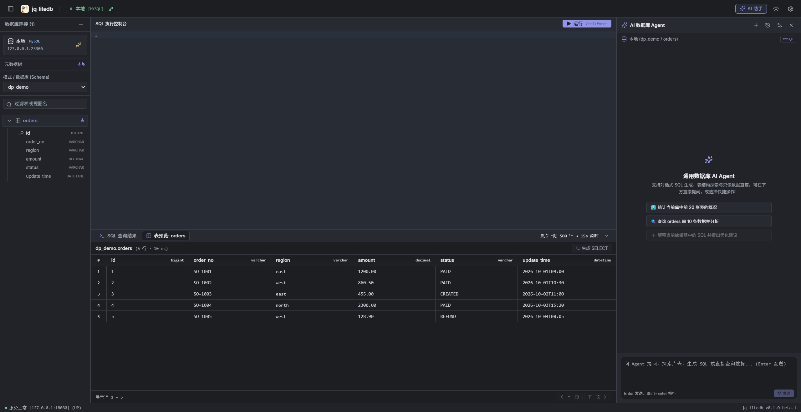
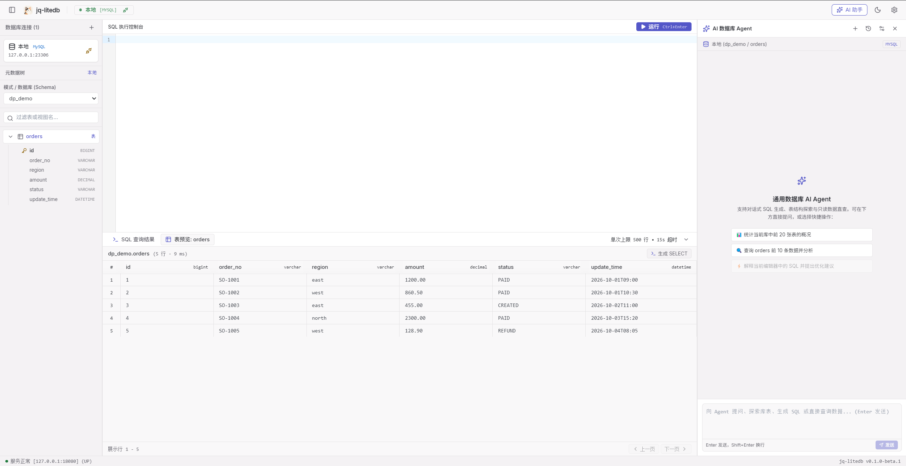

# jq-litedb (LiteSQL Workbench)

[English](README.md) | [简体中文](README.zh-CN.md)

**A local-first, lightweight desktop SQL & Redis workbench designed for developers.**

---

## 📸 Screenshots

### Dark Mode (Default)

### Light Mode

---

## ⚡ Key Highlights

- **Multi-Engine Support**: Built-in support for MySQL (8.0+), PostgreSQL (14+) relational databases, and Redis (6.0+) key-value caching.
- **AST Read-Only Safety Guard**: Enforces AST analysis via JSqlParser to strictly permit only single read-only `SELECT` statements. DML (insert/update/delete), DDL (alter/drop), `SELECT INTO`, and locking reads (`FOR UPDATE`) are physically rejected.
- **Constrained Fast Table Preview**: Fast 100-row preview by default. **Never issues slow full-table `COUNT(*)` queries**, preventing database hiccups on large production tables.
- **Non-Blocking Redis Browser**: Avoids single-threaded bottlenecks by banning `KEYS *` in favor of cursor-based streaming `SCAN`. Features deep inspection for String, Hash, List, Set, and ZSet with an integrated CLI console.
- **BYOK AI SQL Assistant**: Bring Your Own Key (BYOK) to connect any OpenAI-compatible LLM service (DeepSeek, OpenAI, Qwen, etc.). Safely extracts table schemas (zero row data leakage), leaving generated SQL for developer review before manual execution.
- **Clean Software Architecture**:
  - **Zero Scattered Files**: Configuration, SQLite metadata, and logs are 100% consolidated into the Windows standard path `%APPDATA%\jq-litedb\`.
  - **Zero Zombie Processes**: Closing the desktop window cascades and terminates all background processes immediately, releasing memory and network ports cleanly.
  - **Out-of-the-Box**: Self-contained embedded runtime. **No Java runtime or developer SDKs required on the target machine**.

---

## 📥 Download (Windows x64)

Download the latest installer from the [**GitHub Releases Page**](https://github.com/LuffyJJQ/jq-litedb-releases/releases/latest):

- **Installer**: `jq-litedb-Setup-0.2.0.exe` (Supports custom installation path & silent delta updates)

### System Requirements

- **Operating System**: Windows 11 / Windows 10 (64-bit)
- **Prerequisites**: None. Ready to run without installing Java, Node.js, or Python.

---

## 🚀 Features Overview

### 1. Relational Database Management (MySQL / PostgreSQL)
- **Secure Password Storage**: Local hardware-bound AES-256 encryption. Supports single-session in-memory temporary storage when unchecked.
- **Hierarchical Schema Tree**: Inspect databases, schemas, tables, views, primary keys, and column comments on demand.
- **CodeMirror 6 SQL Editor**: Distraction-free query workspace with syntax highlighting, automatic theme sync, and `Ctrl+Enter` shortcut execution.

### 2. Redis Key-Value Management
- **Cursor-based Key Browsing**: Non-blocking `SCAN` iteration with fuzzy pattern matching.
- **Data Structure Inspection**: View and manage String (Text/JSON), Hash, List, Set, and ZSet structures.
- **Safe Redis Console**: Integrated interactive console with automatic blocking of destructive commands.

### 3. Rock-Solid UX & Low-Noise Ergonomics
- **Zero Layout Thrashing**: Physical anchor slots for asynchronous test feedback and status reporting to eliminate content layout jumps.
- **Low-Noise Philosophy**: Clean interfaces without redundant shortcut reminders or visual noise, providing a focused environment for developers.

### 4. BYOK AI Assistant
- Open the AI panel on the right and configure your OpenAI-compatible endpoint (e.g., `https://api.deepseek.com/v1`) and API key.
- Safe local persistence via `%APPDATA%\jq-litedb\ai-settings.json`.
- Translate natural language prompts into syntactically valid read-only SQL with a single click.

---

## 📖 Documentation & Links

- [User Guide](./docs/user-guide.md)
- [Changelog](./CHANGELOG.md)

---

## 💬 Feedback & Issues

Have feedback, questions, or feature requests? Please open an issue on [GitHub Issues](https://github.com/LuffyJJQ/jq-litedb-releases/issues).
